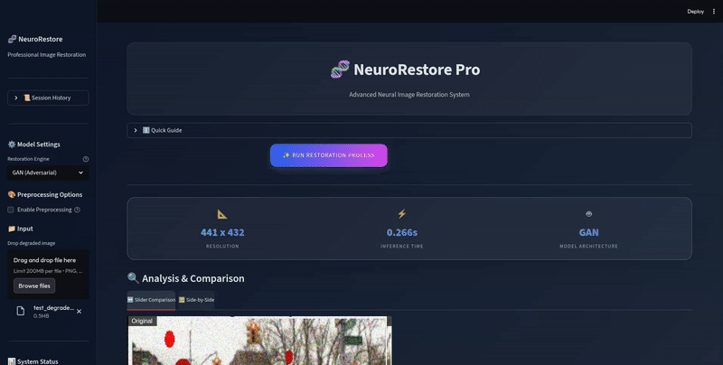

# 🧬 NeuroRestore Pro



## 📋 Overview

**NeuroRestore Pro** is a state-of-the-art image restoration application powered by Deep Learning. It is designed to recover high-quality images from degraded inputs (blurred, noisy, or low-resolution) using advanced generative models.

The application features a modern, glassmorphism-inspired UI built with **Streamlit** and a robust backend API powered by **FastAPI**.

## 🧠 Models

This project utilizes two distinct deep learning architectures for image restoration:

### 1. Variational Auto-Encoder (VAE)
-   **Type**: Probabilistic Generative Model.
-   **Characteristics**: Produces smooth, consistent results. Excellent for denoising but may result in slightly softer edges.
-   **Use Case**: General image cleanup and noise reduction.

### 2. Generative Adversarial Network (GAN)
-   **Type**: Adversarial Model (Generator vs Discriminator).
-   **Characteristics**: Generates sharp, high-frequency details. Capable of hallucinating missing textures to create "crisp" outputs.
-   **Use Case**: Super-resolution and deblurring where detail is critical.

## 📁 Dataset

This project is trained on a subset of the **BDD100K (Berkeley DeepDrive)** dataset.

-   **Source**: `bdd100k_images_10k.zip` (10,000 images subset)
-   **Why BDD100K?**:
    -   **Real-World Diversity**: Contains diverse driving scenes (city streets, highways, residential areas) under various weather conditions (sunny, rainy, overcast) and times of day (day, night).
    -   **Robustness**: The high variability challenges the model to learn robust restoration features, making it effective on "in-the-wild" degraded images rather than just synthetic benchmarks.
    -   **High Resolution**: Provides high-quality ground truth images essential for training super-resolution and deblurring models.

## 🚀 Quick Start

The easiest way to run the project is using **Docker Compose**. This ensures all dependencies (Frontend & Backend) are correctly installed and linked.

### Prerequisites
-   Docker & Docker Compose installed on your machine.

### Launch Instructions

1.  **Clone the repository**:
    ```bash
    git clone <repository-url>
    cd G-AIA-910-PAR-9-1-computervision-7
    ```

2.  **Start the application**:
    ```bash
    docker compose up --build
    ```

3.  **Access the App**:
    -   **Frontend (UI)**: [http://localhost:8501](http://localhost:8501)
    -   **Backend API Docs**: [http://localhost:8000/docs](http://localhost:8000/docs)

## 📥 Model Download

To use the application, you need to download the pre-trained models:

### 1. GAN Model (Generator)
-   **File**: `generator.keras`
-   [Download Link 🔗](https://drive.google.com/file/d/1Mdfvsc75rVbX2yG28MhY_5iS7LKoZcQs/view)

### 2. VAE Models
-   **Encoder**: `vae_encoder.keras`
    -   [Download Link 🔗](https://drive.google.com/file/d/1Rsi7jijLNV4jH84_kFL5zp8WnONabVH0/view?usp=sharing)
-   **Decoder**: `vae_decoder.keras`
    -   [Download Link 🔗](https://drive.google.com/file/d/1q8IaiWgwzOYI224qo5hkpc3aZqLbjxu5/view?usp=sharing)
-   **Weights** (Optional): `vae_weights.weights.h5`
    -   [Download Link 🔗](https://drive.google.com/file/d/1fA0ZGicyRABe-AZj24ct5gf3mO1eqcUK/view?usp=sharing)

### Installation
Place all downloaded files in the `models/` folder at the root of the project:

```
G-AIA-910-PAR-9-1-computervision-7/
├── models/
│   ├── generator.keras
│   ├── vae_encoder.keras
│   ├── vae_decoder.keras
│   └── vae_weights.weights.h5  (optional)
├── src/
└── ...
```

> **Note**: These models are required for the application to work. Without them, the backend will not be able to perform image restoration.

## 🛠️ Training the Models

To reproduce the training results or train on your own dataset, follow these steps.

### Data Preparation
The project includes scripts to fetch and augment datasets:
-   `src/fetch_dataset.py`: Downloads the training data.
-   `src/augmentation.py`: Applies data augmentation (rotations, flips, noise) to increase dataset diversity.

### Training Environment
We recommend using the provided Jupyter Notebooks for training, as they contain the step-by-step training loops and visualization.

1.  **Install Dependencies**:
    It is recommended to use a virtual environment (conda or venv).
    ```bash
    pip install jupyterlab matplotlib
    ```
    Other dependencies should be installed when running the jupyter notebooks.
    However be careful as you might encounter version conflicts or error with tensorflow.
    Those errors are not from this project but inherent to your own device configuration.

2.  **Run Notebooks**:
    -   **VAE Training**: Open `image_reconstructor_VAE.ipynb`
    -   **GAN Training**: Open `image_reconstructor.ipynb`

    Simply press `Run All` to execute all cells and start the training process.
    At first run, you the notebook will have to prepare the dataset and download any required files. It will be then cached for subsequent runs. If you need to regenerate the dataset, you can clear the cache or set `force_regenerate=True` in the `create_augmented_dataset` function.

    > If you're running one of these notebooks on Google colab or alike, don't forget to copy the src folder and its content in your runtime environment.

    Once the training is complete, the models will be saved in the specified directory. (By default `models/`)

### Docker for Training (Optional)
If you prefer to run training in a container, you can use the provided docker in this repo to run jupyter notebook:

```bash
docker compose -f .\docker-compose.jupyter.yml up --build
```

## 🔧 Technologies

-   **Frontend**: Streamlit, Python
-   **Backend**: FastAPI, Uvicorn
-   **ML Framework**: TensorFlow / Keras (implied by .keras models)
-   **Containerization**: Docker
